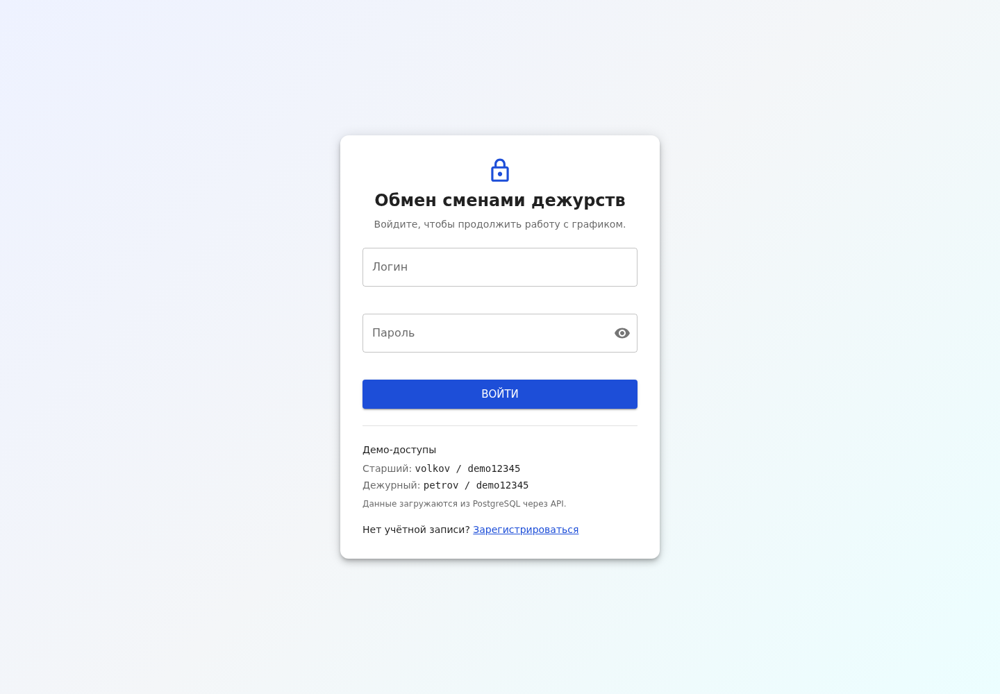
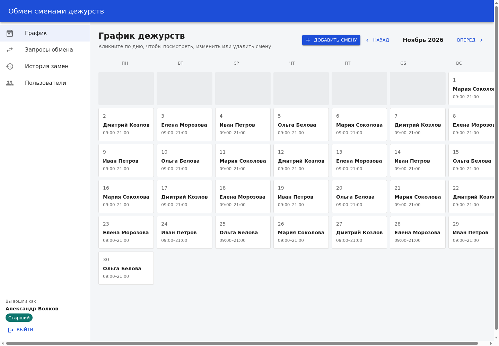
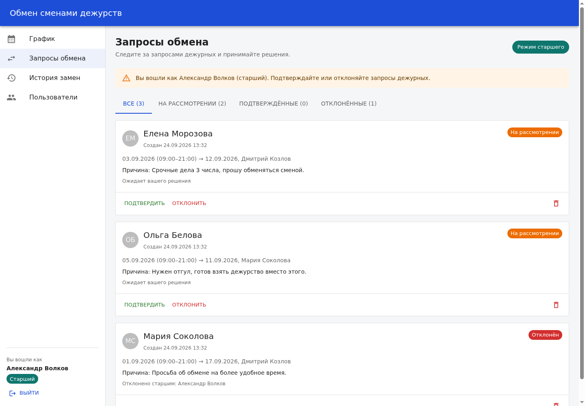
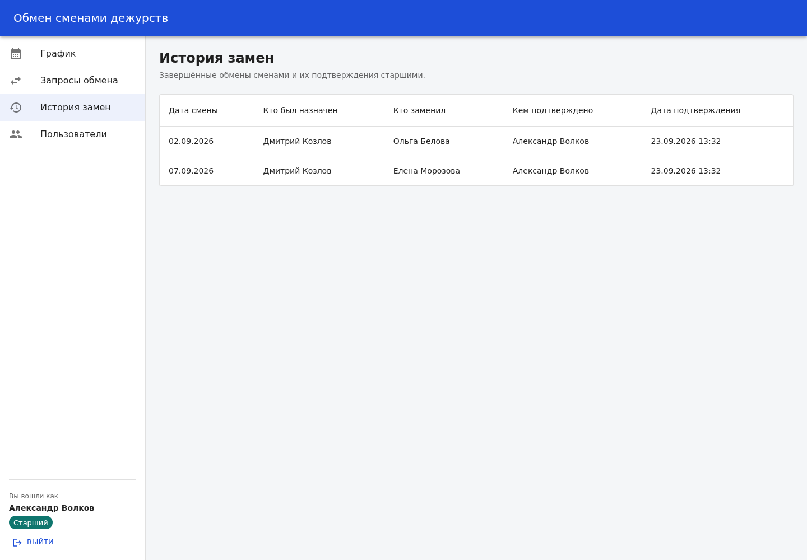
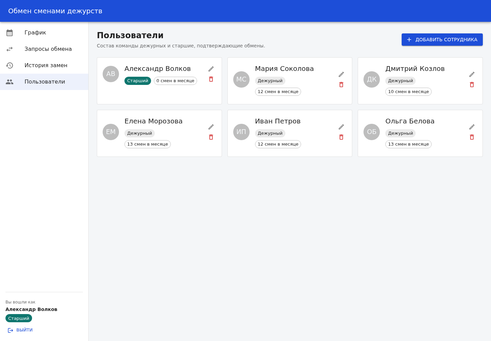
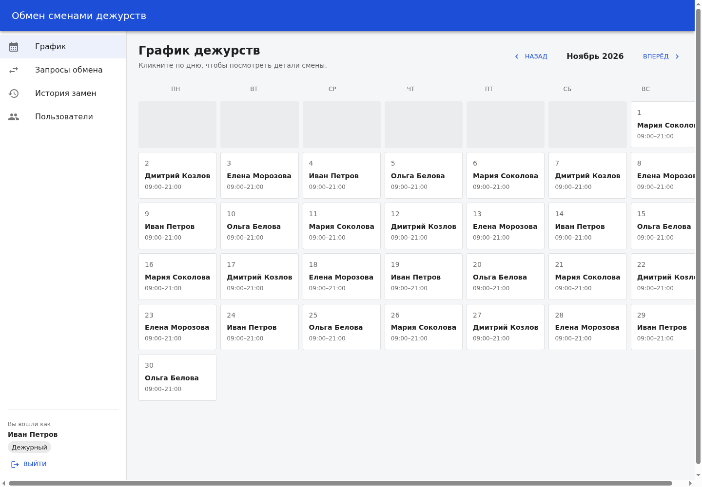
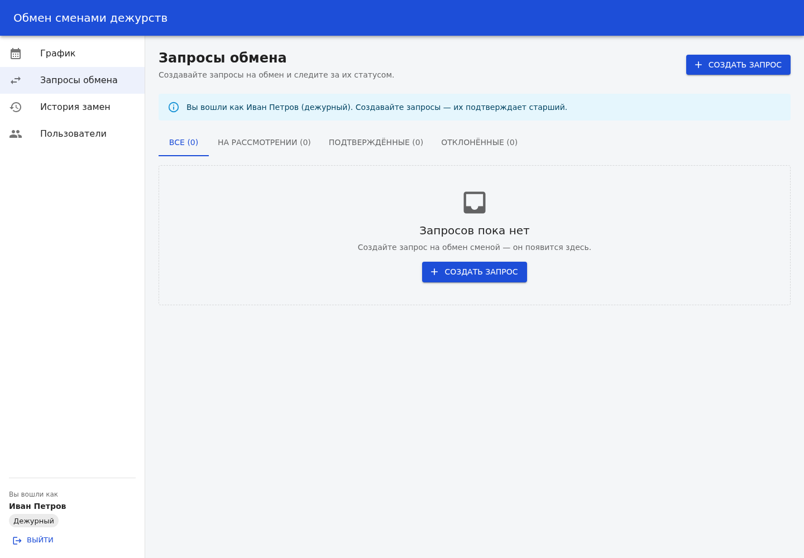

# Обмен сменами дежурств

## Назначение приложения

Приложение помогает команде дежурных управлять сменами: смотреть график на месяц,
создавать запросы на обмен смен между коллегами, а старшим — подтверждать или
отклонять такие запросы. Завершённые обмены фиксируются в истории замен.

## Пользовательские сценарии

1. **Вход в систему.** Пользователь открывает приложение и вводит логин и пароль.
   Роль определяется учётной записью, отдельного выбора роли нет. После входа
   открывается график; пара токенов сохраняется в браузере, поэтому сессия
   восстанавливается после перезагрузки. Выйти можно кнопкой «Выйти» в меню —
   refresh-токен при этом отзывается на backend.
2. **Регистрация.** На странице входа можно создать новую учётную запись дежурного
   (`POST /api/auth/register`). После регистрации пользователь сразу авторизован.
   Роль «старший» самостоятельно получить нельзя.
3. **Просмотр графика.** Пользователь открывает страницу «График», видит, кто
   дежурит в каждый день месяца, переключает месяцы и выбирает день для просмотра
   деталей смены.
4. **Создание запроса на обмен.** Дежурный на странице «Запросы обмена» нажимает
   «Создать запрос», выбирает свою смену, смену коллеги для обмена и указывает
   причину. Форма проверяет, что выбраны две разные смены и причина содержит не
   менее 5 символов. Запрос появляется со статусом «На рассмотрении».
5. **Подтверждение старшим.** Старший видит запросы в статусе «На рассмотрении»
   и может подтвердить или отклонить их. После подтверждения backend в одной
   транзакции меняет владельцев двух смен и добавляет записи в историю; интерфейс
   сразу перезагружает актуальные данные.
6. **Удаление запроса.** Дежурный может удалить свой запрос, старший — любой.
   Перед удалением показывается подтверждение; при отказе backend выводится
   понятное сообщение об ошибке.
7. **Управление сотрудниками.** Старший может добавлять, редактировать и удалять
   сотрудников. Если у сотрудника есть смены или запросы, backend запрещает
   удаление и объясняет причину.
8. **Управление сменами.** Старший может добавлять смену, менять дату, время и
   сотрудника, а также удалять смену. Форма не даёт создать две смены на одну дату
   и проверить, что окончание позже начала.
9. **Просмотр истории.** На странице «История замен» отображается таблица
   завершённых обменов: дата смены, кто был назначен, кто заменил, кем
   подтверждено и когда.
10. **Просмотр состава команды.** На странице «Пользователи» показаны участники,
    их роли (старший/дежурный) и число смен за месяц.
11. **Состояния интерфейса.** При загрузке данных отображаются скелетоны, при сбое —
    сообщение об ошибке с кнопкой «Повторить», при отсутствии данных — пустое
    состояние. Ошибки валидации показываются у полей, отказы в доступе (`403`) и
    конфликты (`400/409`) — в диалоге действия или в Snackbar. Смена состояний
    сопровождается анимациями.

## Экраны

- `/login` - Вход в систему (без общего меню)
- `/` - График
- `/requests` - Запросы обмена
- `/history` - История замен
- `/people` - Пользователи

Неавторизованный пользователь при переходе на защищённый маршрут перенаправляется
на `/login`; после входа возвращается на запрошенную страницу.

## Демо-доступы

Аутентификация выполняется на backend через FastAPI; frontend хранит только пару
токенов и данные пользователя. Пароль всех демо-учётных записей — `demo12345`.
Пароли в PostgreSQL хранятся в виде Argon2id-хешей.

| Логин      | Роль     | Сотрудник         |
| ---------- | -------- | ----------------- |
| `volkov`   | Старший  | Александр Волков  |
| `sokolova` | Дежурный | Мария Соколова    |
| `kozlov`   | Дежурный | Дмитрий Козлов    |
| `morozova` | Дежурный | Елена Морозова    |
| `petrov`   | Дежурный | Иван Петров       |
| `belova`   | Дежурный | Ольга Белова      |

Для проверки сценария модерации и CRUD сотрудников/смен войдите как `volkov`, для
создания запроса — как любой дежурный, например `petrov`. Демо-аккаунты создаются
командой `python -m app.seed`; повторный запуск безопасен и дополнительно
дозаполняет смены текущего месяца.

## Скриншоты



| График (старший) | Запросы (старший) |
| ---------------- | ----------------- |
|  |  |

| История замен | Пользователи |
| ------------- | ------------ |
|  |  |

| График (дежурный) | Запросы (дежурный) |
| ----------------- | ------------------ |
|  |  |

## Технологический стек

- Frontend: React + TypeScript, сборка Vite, React Router, MUI
- Backend: Python + FastAPI, PostgreSQL + SQLAlchemy, Alembic
- Аутентификация: Argon2id, JWT access-токены, opaque refresh-токены с ротацией и отзывом
- Данные frontend: реальные запросы к FastAPI (`fetch`), DTO в snake_case маппятся в
  camelCase-модели frontend
- Автообновление сессии: при `401` клиент один раз пытается обновить access-токен
  через `/api/auth/refresh`; при отказе сессия завершается и пользователь
  перенаправляется на `/login`

## Frontend: архитектура (упрощённый Feature-Sliced Design)

```
frontend/src/
  app/                  # инициализация приложения
    App.tsx             # маршруты
    AppLayout.tsx       # общий каркас: меню, шапка, переходы, выход
    RequireAuth.tsx     # защита маршрутов и проверка сессии
    theme.ts            # тема MUI
    providers/          # AppDataProvider и SessionProvider
  pages/                # страницы маршрутов
    login/              # страница входа
    schedule/           # график дежурств
    requests/           # запросы обмена
    history/            # история замен
    people/             # пользователи
  features/             # действия пользователя
    auth/               # вход, регистрация, валидация, API аутентификации
    exchange-request/   # форма запроса, правила валидации, хук формы
    moderate-request/   # подтверждение и отклонение запросов
    manage-person/      # диалог создания и редактирования сотрудника
    manage-shift/       # диалог создания и редактирования смены
  entities/             # доменные сущности
    person/             # модель, селекторы, карточка и аватар
    shift/              # модель, сетка графика, окно смены
    exchange-request/   # модель, статус, карточка запроса
    replacement/        # модель и таблица истории
  shared/               # переиспользуемый код
    api/                # HTTP-клиент, DTO, мапперы, CRUD-функции, токены
    lib/                # работа с датами и строками
    ui/                 # EmptyState, ErrorState, PageHeader, ConfirmDialog, скелетоны
```

Слои упрощённой FSD: `app → pages → features → entities → shared`. Страницы собирают
интерфейс из сущностей и фич, фичи содержат действия и валидацию, сущности — типы,
селекторы и презентационные компоненты, `shared` — переиспользуемые утилиты,
UI-примитивы и слой доступа к данным.

## Frontend: состояние, данные и валидация

- Глобальное состояние хранится в `AppDataProvider` (`useReducer` + React Context):
  сотрудники, смены, запросы и история. Данные загружаются параллельно из
  `/api/persons`, `/api/shifts`, `/api/requests` и `/api/history`. Провайдер
  начинает загрузку только при наличии авторизованной сессии и сбрасывает данные
  при выходе.
- После каждой мутации (создание/редактирование/удаление, модерация) выполняется
  повторная загрузка данных без скелетона: пользователь сразу видит актуальное
  состояние из PostgreSQL. При первичной загрузке и нажатии «Повторить»
  показывается скелетон.
- `SessionProvider` хранит access-токен, refresh-токен и данные пользователя в
  `localStorage` под ключом `shift-exchange.session`. Пароль в браузере не
  сохраняется. При перезагрузке сессия восстанавливается, access-токен при
  необходимости обновляется автоматически.
- `shared/api/http.ts` добавляет `Authorization: Bearer <access-token>`, разбирает
  ошибки FastAPI (`detail`) и при `401` один раз пробует `/api/auth/refresh`.
  Параллельные `401` используют один общий refresh-запрос. Если refresh отклонён,
  локальная сессия очищается, и `RequireAuth` перенаправляет на `/login`.
- `RequireAuth` защищает маршруты приложения: без сессии пользователь попадает на
  `/login`, после входа возвращается на исходный маршрут. При истечении сессии
  возврат происходит автоматически.
- Роль определяется учётной записью. Дежурный видит кнопку создания запроса и
  может удалить только свой запрос; кнопки модерации и управления сотрудниками и
  сменами ему недоступны. Старший видит все запросы, подтверждает/отклоняет их и
  управляет сотрудниками и сменами. Backend дополнительно проверяет права и
  возвращает `403`, если действие запрещено.
- `AppDataProvider` не эмулирует операции локально: подтверждение запроса,
  изменение владельцев смен и запись истории выполняются backend в одной
  транзакции, после чего frontend перечитывает данные.
- Форма входа (`features/auth`) проверяет заполнение логина и пароля, показывает
  ошибку неверных учётных данных и блокирует кнопку на время запроса. Форма
  регистрации проверяет длину логина, пароль не короче 8 символов и совпадение
  паролей; ошибка `409` («логин занят») выводится в форме.
- Форма запроса (`features/exchange-request`) проверяет: выбрана ли своя смена, не
  совпадает ли она с целевой, принадлежит ли целевая смена другому сотруднику,
  длина причины 5–300 символов. Ошибки показываются после blur или попытки
  отправки; серверная ошибка выводится в диалоге, который не закрывается при сбое.
- Диалоги сотрудника и смены валидируют обязательные поля, время и дубликат даты.
  Ошибки backend (`400`, `403`, `409`, `422`) показываются в диалоге или Snackbar.
- На экранах данных предусмотрены состояния загрузки (скелетоны), ошибки (с кнопкой
  «Повторить») и отсутствия данных (для месяцев без смен, пустых фильтров, истории
  и команды).
- Анимации: MUI Fade для смены маршрута и месяца, Slide для диалогов, Grow для
  карточки входа и карточек, Collapse для ошибок и блока действий, Snackbar для
  результата действий.

## Модель данных

PostgreSQL, таблицы создаются миграциями Alembic (`backend/alembic`).

| Таблица            | Поля и связи                                                                  |
| ------------------ | ----------------------------------------------------------------------------- |
| `persons`          | id (PK), name, role (`senior`/`guard`).                                       |
| `users`            | id (PK), person_id (FK → persons, CASCADE, UNIQUE), login (UNIQUE), password_hash (Argon2id), is_active, created_at. |
| `refresh_tokens`   | id (PK), user_id (FK → users, CASCADE), token_hash (SHA-256, UNIQUE), created_at, expires_at, revoked_at. |
| `shifts`           | id (PK), date, start_time, end_time, person_id (FK → persons, RESTRICT).      |
| `exchange_requests`| id (PK), requester_id (FK → persons), shift_id (FK → shifts), target_shift_id (FK → shifts), reason, status (`pending`/`approved`/`declined`), created_at. |
| `replacement_history` | id (PK), shift_id (FK → shifts), from_person_id (FK → persons), to_person_id (FK → persons), approved_by_id (FK → persons), approved_at. |

Связи: у сотрудника (`persons`) может быть одна учётная запись (`users`);
у неё много refresh-токенов; у сотрудника много смен и созданных запросов;
смена принадлежит одному сотруднику; запрос ссылается на две смены; запись
истории фиксирует замену на конкретной смене и подтвердившего её старшего.

Бизнес-правила: запрос создаёт только дежурный за свою смену; подтвердить
может только старший и только запрос в статусе `pending`; при подтверждении
в одной транзакции меняются владельцы обеих смен и добавляются две записи
в `replacement_history`.

## Backend: аутентификация и права

- Пароли хранятся только в виде Argon2id-хешей (`pwdlib[argon2]`), исходный
  пароль в БД не сохраняется.
- `POST /api/auth/register` создаёт сотрудника с ролью `guard` и учётную
  запись. Самостоятельно зарегистрироваться старшим нельзя.
- `POST /api/auth/login` проверяет логин и пароль и возвращает пару токенов.
  Access-токен — JWT HS256 на 15 минут, refresh-токен — случайная строка на
  7 дней; в БД хранится только SHA-256-хеш refresh-токена.
- `POST /api/auth/refresh` проверяет срок и статус refresh-токена, отзывает
  старый токен и выдаёт новую пару (ротация). Неверный, истёкший или уже
  отозванный токен отклоняется с `401`.
- `POST /api/auth/logout` требует access-токен и отзывает refresh-токен
  текущей сессии. `GET /api/auth/me` возвращает текущего пользователя.
- Все доменные маршруты (`/api/persons`, `/api/shifts`, `/api/requests`,
  `/api/history`) требуют `Authorization: Bearer <access-token>`.
- Дежурный видит только свои запросы и может удалить только свой запрос.
  Старший видит все запросы и может подтверждать/отклонять их. Создание,
  изменение и удаление сотрудников и смен доступны только старшему.
- `requester_id` и `approved_by_id` больше не принимаются от клиента: они
  берутся из проверенного access-токена.

## Backend: структура

```
backend/
  app/
    main.py             # FastAPI, CORS, подключение роутеров
    config.py           # настройки (.env через pydantic-settings)
    database.py         # engine, SessionLocal, Base, get_db
    models.py           # сущности SQLAlchemy, включая users и refresh_tokens
    schemas.py          # Pydantic-схемы валидации и ответов
    security.py         # Argon2id, JWT, генерация и хеширование refresh-токенов
    auth.py             # регистрация, вход, refresh, logout, проверка прав
    crud.py             # операции с данными и бизнес-логика
    seed.py             # загрузка демо-данных и демо-учётных записей
    routers/            # API: auth, persons, shifts, requests, history
  alembic/             # миграции БД
  tests/               # pytest-тесты
  docker-compose.yml   # PostgreSQL
  .env.example         # пример настроек без секретов
```

## Запуск backend

Требуется Python 3.11+ и Docker (для PostgreSQL).

1. Запустить PostgreSQL:

```bash
cd backend
docker compose up -d db
```

2. Настроить окружение (скопировать и при необходимости менять пароли):

```bash
cp .env.example .env
```

Обязательно замените `JWT_SECRET_KEY` на длинную случайную строку, например:

```bash
python3 -c "import secrets; print(secrets.token_urlsafe(64))"
```

Сроки жизни токенов задаются в `.env`: `ACCESS_TOKEN_TTL_MINUTES=15` и
`REFRESH_TOKEN_TTL_DAYS=7`.

3. Создать виртуальное окружение и установить зависимости:

```bash
python3 -m venv .venv
source .venv/bin/activate
pip install -r requirements.txt
```

4. Создать таблицы (миграции):

```bash
alembic upgrade head
```

5. Залить демо-данные (по желанию):

```bash
python -m app.seed
```

6. Запустить сервер:

```bash
uvicorn app.main:app --reload
```

Документация API: http://localhost:8000/docs, проверка: `/api/health`.

### Основные эндпоинты

- `POST /api/auth/register`, `POST /api/auth/login`, `POST /api/auth/refresh` — публичные
- `POST /api/auth/logout`, `GET /api/auth/me` — требуют access-токен
- `GET/POST /api/persons`, `GET/PATCH/DELETE /api/persons/{id}` (изменения — только старший)
- `GET/POST /api/shifts` (фильтр `?month=YYYY-MM`), `GET/PATCH/DELETE /api/shifts/{id}`
  (изменения — только старший)
- `GET/POST /api/requests` (фильтр `?request_status=`), `GET/DELETE /api/requests/{id}`,
  `POST /api/requests/{id}/approve`, `POST /api/requests/{id}/decline` (модерация — только старший)
- `GET /api/history`, `GET /api/history/{id}`
- `GET /api/health` — публичная проверка доступности

Доменные эндпоинты принимают заголовок `Authorization: Bearer <access-token>`.
В Swagger UI токен можно получить через `/api/auth/login` и вставить кнопкой
«Authorize».

## Тесты

```bash
cd backend
source .venv/bin/activate
pytest
```

Тесты используют отдельную базу `shift_exchange_test` (создаётся автоматически)
и покрывают Argon2id-хеши, регистрацию и вход, сроки и ротацию refresh-токенов,
отзыв токена при logout, отклонение неверных/истёкших токенов, защиту маршрутов,
разграничение доступа дежурного и старшего, а также полный сценарий обмена
с подтверждением.

## Запуск frontend

Требуется Node.js 18+ и npm. Перед запуском frontend поднимите PostgreSQL и backend
по инструкции выше: без доступного API экран входа покажет ошибку соединения.

```bash
cd frontend
cp .env.example .env
npm install
npm run dev
```

`VITE_API_URL` задаёт адрес backend (по умолчанию `http://localhost:8000`). Если
backend запущен на другом адресе, измените переменную в `frontend/.env` и добавьте
origin frontend в `CORS_ORIGINS` backend.

Приложение откроется на http://localhost:5173. Войдите под одной из
[демо-учётных записей](#демо-доступы), например `petrov / demo12345` (дежурный) или
`volkov / demo12345` (старший). Новые сотрудники, смены и запросы сохраняются в
PostgreSQL и остаются после перезагрузки страницы и перезапуска сервера. Сессия
хранится в `localStorage` и восстанавливается после перезагрузки; access-токен
обновляется автоматически.

Проверка типов и production-сборка:

```bash
npm run typecheck
npm run build
```
